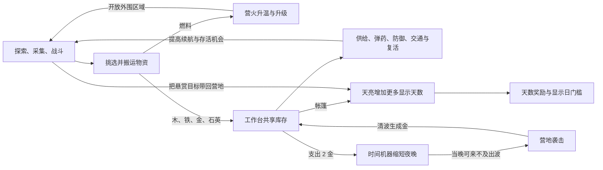

# 100 Days After Fall｜04 玩法系统与联动

依据 **After Fall** 局内 Place（`108983613755535`，版本 7）的脚本、配置和场景对象静态还原。普通模式是主线。第三章记录日夜触发时间，本章关注玩家在同一时刻能做什么选择、花掉什么、给全队带来什么。

## 一局里并行推进的三件事

1. **开地图。** 把燃料投入营火，升火扩边界。外围据点提供新的战利品和目标，悬赏据点分布在 3–6 级区域。
2. **扩能力。** 把物资搬进公共工作台，升级、造生产设施、造防御或做弹药。同一份库存支撑全队，投入一个方向会推迟其他方向。
3. **推天数。** 帐篷与交付悬赏提高每次天亮的天数增量。它们能提前跨过奖励和显示天数门槛，营地袭击与满月仍按实际阶段充能。

## 玩家选择、成本和收益

| 系统 | 玩家选择与成本 | 可确认的收益与联动 |
| --- | --- | --- |
| **探索、建筑与战利品** | 在已开放区域内选择路线。普通资源点会尝试随机落点，建筑首次进入时按建筑等级的资源池生成物品，并按预设生成敌人。深入意味着更多路程、饥饿和遭遇风险。 | 移动揭开格子迷雾并向全队广播。普通宝箱按玩家记录开启，战利品生成在宝箱点位。开出枪械时还会生成对应弹药。共享建筑地面资源与按玩家记录的宝箱，是两种不同的队伍分配方式。 |
| **采集、拖拽与搬运** | 选择砍树、捡地面资源、敲有掉落池的矿脉，或腾出背包位去搬高价值物品。普通树基础掉 3 木，大树基础掉 16 木、4 种子，部分职业可额外产出。基础袋容量为 5、15、25，另加马袋和角色或永久加成。 | 木料可烧或回收。背包用对象数量与容量比较，同样占一个袋位的铁件可有不同回收量，例如 Iron Rock 3 铁、Iron ingot 5 铁、Iron trolley 7 铁。带哪件回家会改变这一趟产出。 |
| **饥饿与食物** | 长距离冲刺会追加饥饿消耗。吃食物可立即补给，把可烤物带回点燃的营火可以转换成烤熟版本，做锅后可投 3 份符合条件的食材启动煮汤。 | 普通 Meat 配置回 15 饥饿，烤熟版回 30，普通角色吃生肉还扣 10 生命。饥饿为零后按每秒循环扣最大生命的 10%。营火与生产设施提高探索续航，食材也会占搬运空间。 |
| **营火与扩图** | 把干燥燃料投火。普通木头 +2 热，煤 +4、动物脂肪 +6、油 +8。达到当前档热量上限可升级；维持火源则要持续补燃料。 | 6 档营火基础范围从 30 增至 60。升级会移动地图空气墙，并在 3–6 级依次开放四条普通悬赏的牌面交互。亮火范围内有回血、补灯油，也影响野外夜怪的出现。灭火会失去亮火相关收益，地图边界更新由等级变化驱动。 |
| **公共工作台与建造** | 投料后木、铁、金、石英记入一套共享库存。普通木类每件回收为 1 木；铁和金按物品参数入账；石英每件 +1 水晶。制作消耗库存，建造类通常先拿蓝图，再摆放。 | 五级工作台打开不同配方。早期可在地图、帐篷和升级间取舍，中期能造农田、墙、陷阱和锅，后期可投入弹药、传送、复活和缩夜。带有相应建造职业标签的玩家有 20% 概率免普通制作材料、10% 概率免弹药材料。 |
| **威胁、战斗与防守** | 平常夜晚可依靠亮火规避部分野外刷怪。营地袭击从外围刷敌并向营火移动，需要留人守营。玩家还可主动挑战悬赏据点或宝石塔，承担战斗和弹药开销。 | 最后一名营地袭击敌人移出袭击容器时生成金并触发防守完成。宝石塔清完配置波次后开放宝箱和保险箱，有 180 秒领奖窗口，随后进入 1200 秒冷却。 |
| **悬赏与天数推进** | 在 3–6 级区域找四座据点，战斗后把目标运进营火范围。完成检查按目标与营火的距离进行，走的是悬赏交付分支。 | 写入全队悬赏完成标记，每项在以后每次天亮额外 +1 显示天数。帐篷也提高同一个增量，因此外出攻坚与留营建造都能推进长期天数。 |
| **队伍协作与死亡救援** | 队友可以分开采集、搬运、守营。地图标记服务要求存活、营火点燃且落点在当前开放区域。有人死亡时，可用医疗道具营救；特定能力会改走扣救援者生命的分支。 | 地图探索、营火、工作台、悬赏和天数都是队伍共同进度。饥饿、生命和背包属于个人。普通死亡会掉出袋中物品，部分医疗工具和铃铛也会掉落；救援能保留队伍继续分工的能力。 |

### 地图与后期支线

- **宝石塔**是独立的分波挑战。守营后得到的金可回流工作台，宝石塔则在清波后开放神器宝箱、宝石宝箱与铁、金保险箱。可以把它看成一次主动用时间和战斗资源换战利品的行动。
- **武器工坊**尝试落在 4 级区，启用开关在当前版本为真。靠近工坊会揭示齿轮资源点，资源点配置在 3、4、5 级区域。门默认装有 1 个齿轮，还需交 3 个齿轮。进门后操作供电开关，三台机器分别接受 1 个火鸡王羽毛、3 件 Gold、木料累计参数值 20，产出枪管、枪身和枪托。提交三件零件后生成 **Iron Verdict Rifle**。这条路线把扩图、Boss 掉落、物资搬运与战斗装备连在一起。木料在这里按物品参数累计，与普通工作台每件木料计 1 的口径不同。

## 关键成本和机会成本

| 目标 | 已核实成本 | 同一资源还可以怎么用 |
| --- | --- | --- |
| 工作台升 2 / 3 级 | 5 木 + 1 铁 / 15 木 + 10 铁 | 同批木可烧火扩图，或用来造 20 木的旧帐篷、12 木的木墙。 |
| 工作台升 4 / 5 级 | 20 木 + 30 铁 + 2 金 / 45 木 + 35 铁 + 4 水晶 | 金可留给交通和后期设施，铁可先补战斗消耗。 |
| 工作台造弹药 | 2 / 4 / 6 铁，分别产出一份手枪 / 步枪 / 霰弹枪弹药，物品参数为 10 / 8 / 8 发 | 需要在接下来一战的弹药与永久解锁之间分配铁。 |
| 时间机器 / 复活棺材 | 两者造价各为 40 木 + 30 铁 + 6 金 + 2 水晶 | 时间机器每次 2 金，用于缩短即将到来的夜间阶段；棺材首次激活 2 金，每使用一次后下次激活价翻倍。 |
| 传送车站 | 单站 25 木 + 15 铁 + 1 金，至少两站才可用 | 两站时目的地确定，更多站时会随机去另一站。建第三站以后，路线覆盖提高，指定回营的确定性降低。 |

**两处会直接影响策划判断的文案差异。** 传送车站文案写可传到任意已造站点，脚本实际随机抽站。普通 Farm Plot 文案写每 2 天，蓝图 204 的实际判定是距上次成功生长至少 **3 个显示日**。增加换日倍率会加快触发生长检查的日数进度。

## 源码定位

下表的 `S` 指 `ServerScriptService`，`R` 指 `ReplicatedStorage.src`。行号对应本次读取的 Studio 编辑态源码。

| 系统 | 代码或配置 |
| --- | --- |
| 区域、建筑、宝箱 | `S.MapService` 246–273、1307–1358；`S.Game.BuildingServer` 13–53、78–108；`S.Game.GameController` 537–591、645–649。 |
| 采集、背包与回收 | `R.Helpers.GameHelper` 752–774、1331–1381；`R.Helpers.BagHelper` 99–108；`S.BagService` 64–97；`R.ExcelConfig.ResourcesItemSetting` 4–6、51–79、94。 |
| 饥饿、烹饪与营火 | `S.Game.Behaviour.玩家行为Service` 41–86；`R.Helpers.GameHelper` 229–268；`S.Game.WokService` 19–45；`S.Game.CampfireService` 120–145、195–260、306–359、373–425；`R.ExcelConfig.CampfireSetting` 4–9。 |
| 配方、公共库存与建造 | `S.Game.CraftingBenchService` 239–368、373–423；`StarterGui.UICraftItem.LocalScript` 292–329、411–430；`R.ExcelConfig.CraftItemSetting` 4–40；`CraftBulletSetting` 4–6；`ResourcesItemSetting` 121–123。 |
| 悬赏、夜袭和宝石塔 | `R.ExcelConfig.WantedSetting` 4–7；`S.Game.WantedStrongholdService` 11–62；`Workspace.Prefabs.Map.WantedBoard.Wanted.WantedBoardScript` 40–54、66–105；`R.Helpers.GameHelper` 1205–1223；`S.Game.营地突袭` 50–89、93–142；`S.Game.GemTowerService` 68–104、126–191。 |
| 武器工坊 | `S.MapService` 329–381；`S.Game.GearSourceService` 275–329；`R.ExcelConfig.GearSourceSetting` 4–39；`GearMechanismSetting` 8–15；`S.Game.GearMechanismDoorService` 408、515–517、551–574、671–696；工坊开关预设的 `WeaponWorkshopPower_server` 186–211；`WeaponWorkshopSetting` 12–42、75–90；`S.Game.WeaponWorkshopService` 1245–1283、1673–1682。 |
| 协作、救援与设施 | `S.MapMarkerService` 154–159、281–300；`S.Game.GameController` 157–215、596–642；`R.Helpers.GameHelper` 346–390；`Workspace.Prefabs.蓝图.403.传送车站` 12–34；`501.复活棺材` 47–70；`502.时间机器_server` 22、82–104；`204.普通种田` 17–30。 |

选取的是能改变探索、生产、防守和团队分工的主线与代表性支线。每个职业、武器、Boss 和活动的独立规则适合继续按其对应脚本补充。
