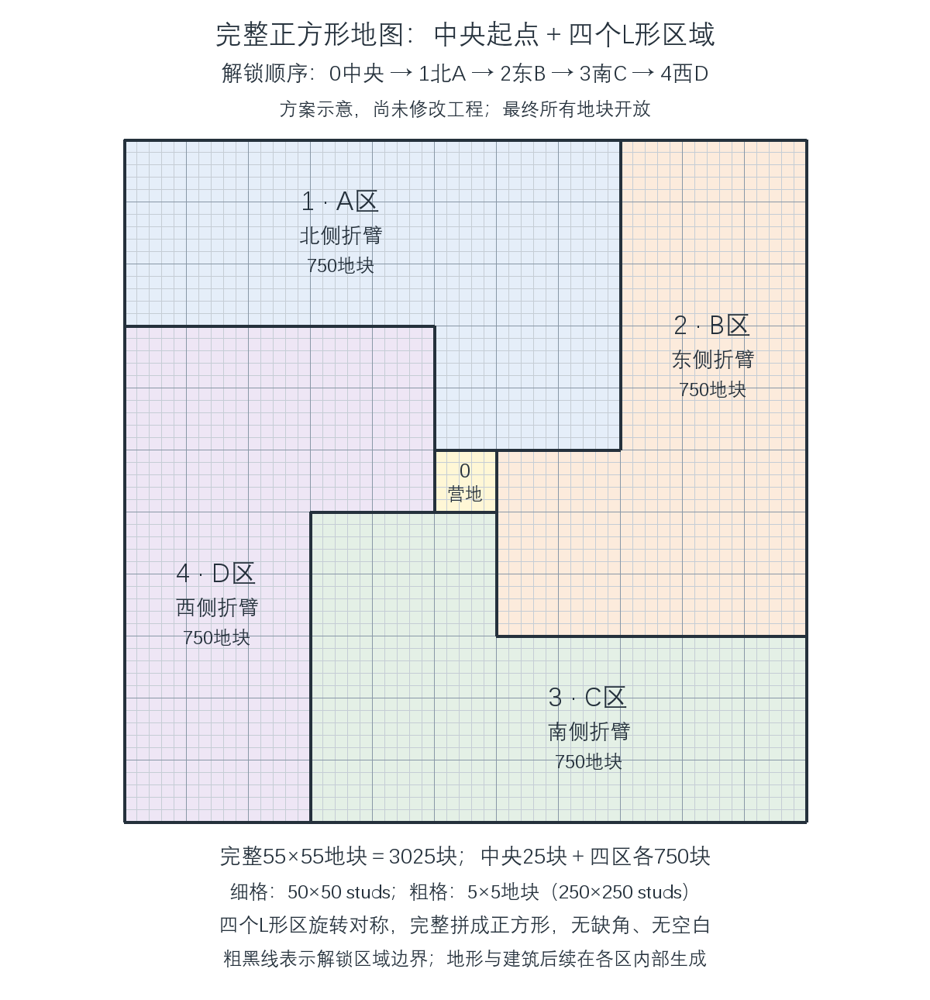

# 正方形地图的卍形顺时针分区方案

这是拟议布局，尚未修改Studio工程。保持现有55×55个基础地块、2750×2750 studs的完整正方形外轮廓。



| 阶段 | 区域 | 规划大格数 | 基础地块数 |
| --- | --- | ---: | ---: |
| 初始0 | 中央营地，5×5基础地块 | 1 | 25 |
| 1 | A北侧L形区 | 30 | 750 |
| 2 | B东侧L形区 | 30 | 750 |
| 3 | C南侧L形区 | 30 | 750 |
| 4 | D西侧L形区 | 30 | 750 |
| 合计 | 完整正方形 | 121 | 3025 |

四个L形区旋转对称，每区都直接邻接中央营地。按A→B→C→D依次开放，已开放区域保持开放。颜色表示解锁区域，不代表已确定的地貌主题；粗黑边是分区边界，不代表正式场景已经设置墙体或道路。

最终布局按11×11规划大格表示如下，每个字母格包含5×5个基础地块：

```text
A A A A A A A A B B B
A A A A A A A A B B B
A A A A A A A A B B B
D D D D D A A A B B B
D D D D D A A A B B B
D D D D D 0 B B B B B
D D D C C C B B B B B
D D D C C C B B B B B
D D D C C C C C C C C
D D D C C C C C C C C
D D D C C C C C C C C
```

已验证121个规划格全部唯一归属、总数3025个基础地块，并且初始及每一步解锁后的区域均通过四邻接连通。

[可编辑SVG](03_正方形地图_卍形顺时针分区方案.svg) · [格子归属JSON](03_正方形地图_卍形顺时针分区方案.json)
