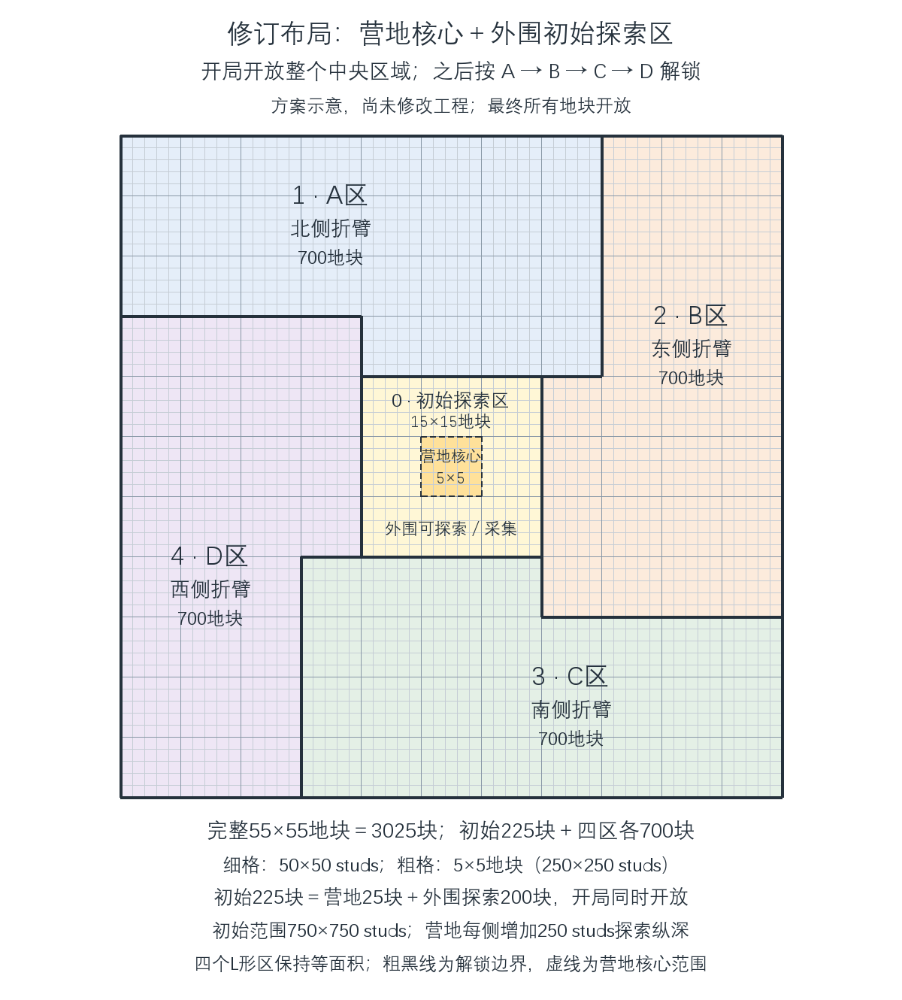

# 修订方案：营地核心与初始探索区分开

保留55×55基础地块的正方形全图及A→B→C→D顺时针解锁。将开局开放范围从5×5扩大为15×15基础地块；中央5×5仍是营地核心。此为供审查的布局方案，尚未修改Studio工程。

| 范围 | 尺寸 | 基础地块数 | 用途与开放方式 |
| --- | --- | ---: | --- |
| 营地核心 | 5×5地块，250×250 studs | 25 | 营火、制造台、出生点等；初始开放 |
| 外围初始探索带 | 营地四周各延伸5地块 | 200 | 初始可探索、采集，容纳低风险遭遇与少量小型资源点；与营地同时开放 |
| 初始区域合计 | 15×15地块，750×750 studs | 225 | 核心25＋外围200；是旧版初始面积的9倍 |
| A区 | 北侧L形 | 700 | 第一阶段解锁 |
| B区 | 东侧L形 | 700 | 第二阶段解锁 |
| C区 | 南侧L形 | 700 | 第三阶段解锁 |
| D区 | 西侧L形 | 700 | 第四阶段解锁 |
| 全图合计 | 55×55地块，2750×2750 studs | 3025 | 225＋4×700，无遗漏与重叠 |

225块初始区包含营地核心，不是再额外增加225块。新增的外围200块可承载基础木材/石料/食物、邻近水源与小型废墟，具体内容待后续配置；不意味着整片初始范围都使用营地安全规则，也不意味着开局就移除全部探索迷雾。

为保持后续四区的意义，初始探索带建议只配置基础资源和低风险遭遇。高级制造材料、稀有资源、大型功能建筑与关键解锁目标放在后续区域。图中15×15是当前建议值，尚未作为最终配置定稿。

图中粗黑线代表区域解锁边界，营地核心的虚线仅作范围区分，并非必须放置实体围墙。四个外区均直接邻接初始探索区；已检查初始及每个顺时针开放阶段的四邻接连通性。整个初始区与外区的格子归属唯一。

坐标采用现有1起始的55×55基础格：初始区x/z均为21～35，营地核心均为26～30。每个11×11规划大格仍代表5×5个基础地块，初始区占3×3规划大格，外区各占28格。

[可编辑SVG](04_正方形地图_扩大初始探索区方案.svg) · [格子归属JSON](04_正方形地图_扩大初始探索区方案.json)
