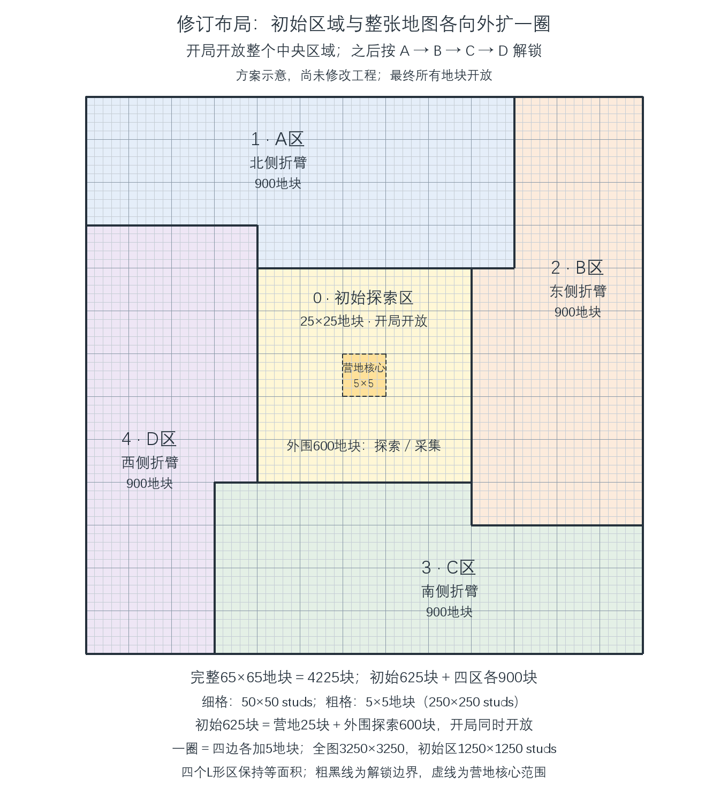

# 中心区域与全图各外延一圈

根据上一版继续扩大：“一圈”按图中一个规划粗格计，即四边各增加5个基础地块（250 studs），因此边长增加10个地块。此为布局修订，尚未修改Studio工程或运行配置。

| 项目 | 上一版 | 本版 |
| --- | --- | --- |
| 营地核心 | 5×5，25地块 | 保持5×5，25地块 |
| 初始开放总范围（含营地） | 15×15，225地块 | 25×25，625地块 |
| 营地外围初始探索带 | 200地块 | 600地块 |
| 整张地图 | 55×55，3025地块 | 65×65，4225地块 |
| A／B／C／D单区 | 各700地块 | 各900地块 |
| 全图边长 | 2750 studs | 3250 studs |
| 初始范围边长 | 750 studs | 1250 studs |

初始625地块包含营地核心25块，营地四周各有10基础地块（500 studs）的探索纵深。四个外区仍是旋转对称的L形区，按A北→B东→C南→D西顺时针解锁。

总数625＋4×900＝4225。与上一版相比，全图增加1200地块，其中初始范围增加400，四个外区各增加200。13×13规划格全部有唯一归属；每个规划格包含5×5个基础地块。已核对初始及四次开放后的四邻接连通性，所有外区均与初始范围直接相邻。

本版65×65基础格坐标中，初始区域x/z为21～45；营地核心x/z为31～35。布局中的颜色只表达解锁区域，生态地貌与建筑仍待分配。图中虚线只表示营地核心，不是新增解锁边界。

[可编辑SVG](05_正方形地图_中心与全图外延一圈.svg) · [格子归属JSON](05_正方形地图_中心与全图外延一圈.json)
