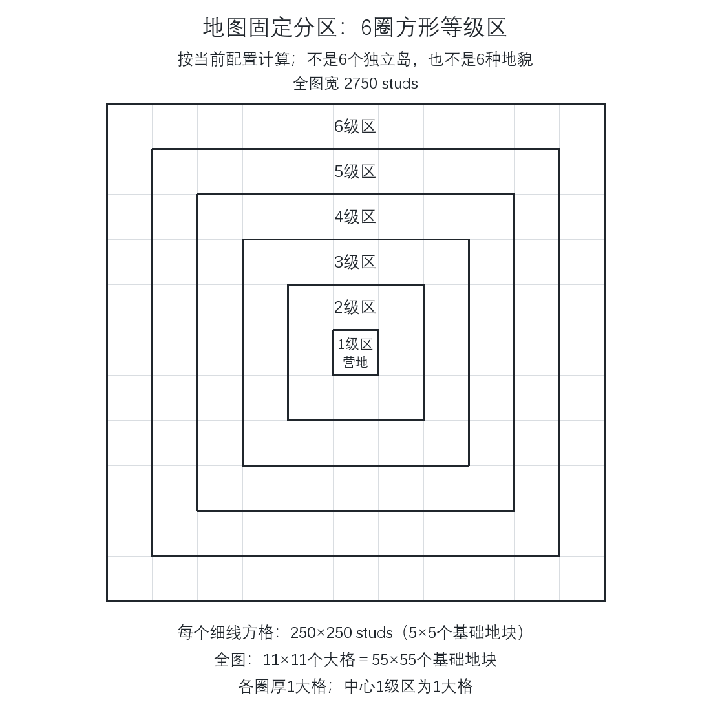
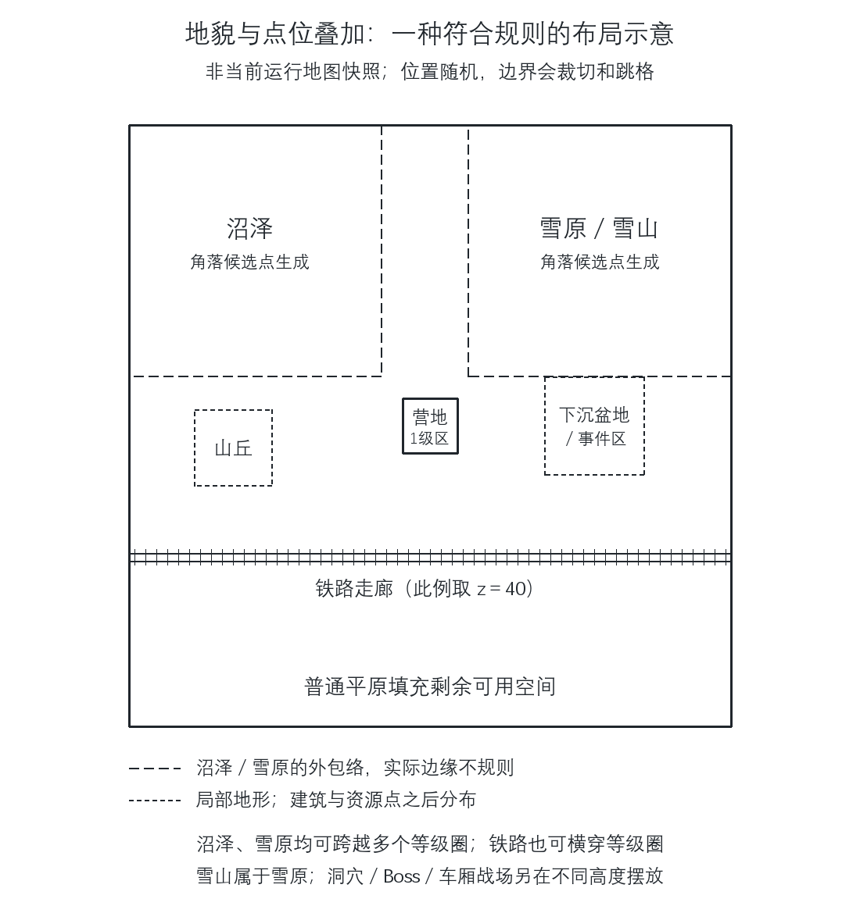

# 当前局内地图生成分区与线框图

2026-11-19，通过 Studio 只读接口核对当前编辑态配置和脚本。没有启动游戏、重新生成地图或改动场景。这里说明**当前生成规则**；地貌示意图不是某一局的实际随机结果。

## 固定层：6个方形等级区

当前配置：基础地块宽50 studs；5×5个基础地块组成一个250×250-stud的大格；整图11×11个大格，即55×55个基础地块，总边长2750 studs。

以大格坐标 (6,6) 为中心，等级由 `max(abs(x-6),abs(z-6))+1` 决定，因此形成6层同心方形分区。表中数量是逻辑格数，区域面积不等于实际可走面积，也不代表最终场景实例数量。

| 区域 | 形状／位置 | 本区大格数 | 本区基础地块数 | 包含内圈后的总外框边长 |
| --- | --- | ---: | ---: | ---: |
| 1级区 | 中心，营地所在范围 | 1 | 25 | 250 studs |
| 2级区 | 第一层外环 | 8 | 200 | 750 studs |
| 3级区 | 第二层外环 | 16 | 400 | 1250 studs |
| 4级区 | 第三层外环 | 24 | 600 | 1750 studs |
| 5级区 | 第四层外环 | 32 | 800 | 2250 studs |
| 6级区 | 最外环 | 40 | 1000 | 2750 studs |
| 合计 | 11×11大格 | 121 | 3025 | — |

默认营地初始化覆盖中心5×5基础地块，并把其中一个边缘位置替换为池塘。因此中心营地区域在逻辑位置上等于1级区，但最终25格不全保留 `campfireLand` 类型。营火/制造台/悬赏牌放在中心附近。

## 环境层：3类主要生态地貌，叠加局部地形和点位

**普通平原、沼泽、雪原**是主要地表生态类型，不与6个等级区一一对应。其他元素是局部空间或走廊，不宜并称为互斥的“第7区、第8区”。

| 环境要素 | 当前生成方式 | 数量与位置限制 |
| --- | --- | --- |
| 普通平原／草地 | 生成完特殊地貌后填充未占用的基础格；5级/6级普通地块有专用模板 | 剩余空间；少量格可随机成为池塘 |
| 沼泽 | 当前开关为开启；从基础格中心(10,45)、(45,10)、(10,10)、(45,45)随机尝试一个中心 | 一次初始化尝试创建一片；半径参数13，循环覆盖中心±13；越界裁切，最外边缘随机跳过，可含水地、池塘、泥沼、毒沼泽 |
| 雪原／雪山 | 当前开关为开启；使用相同4个角落候选中心，在沼泽占位后寻找可用位置；中心放雪山控制器 | 一次初始化尝试创建一片；直径配置26，代码半径ceil(26/2)=13，双闭区间最大包络为27×27基础格，再按边界裁切/跳格；并非严格26×26 |
| 山丘／高原 | 在2级区以外寻找未占用位置，抬升地面，中心附近使用高原模板 | 目标1处，最多100次尝试；当前雪地开启使半径缩为3，最大包络7×7基础格；放置失败可为0处 |
| 下沉盆地／事件区 | 寻找中心等级为4的位置，生成下沉地形，再选择普通坑、雷神锤或老矿镇事件 | 目标1处，半径4，最大地形包络9×9基础格；当前雷神锤与老矿镇开关开启；受可用空间影响 |
| 铁路走廊 | 当前火车大劫案开关开启；从横/纵贯穿主图的4条候选线中选择一条完全未占用的线 | 候选为基础格 x=16、x=40、z=16、z=40；成功后生成一条贯穿铁路，两端是出入口；没有合法候选可能不生成 |
| 水体／岸线 | 普通池塘、营地池塘、沼泽池塘/水地、雪原池塘分别生成 | 属于以上生态/营地区域内的局部地块，不能简单统计成一整片独立水域区 |
| 建筑／资源／事件点 | 在等级候选格与合法地表上安放；宝石塔、医院、工坊、据点、矿镇等有各自规则 | 是点位、建筑占地或组合场景，不构成新的连续等级环 |

上图选择沼泽位于左上、雪原位于右上、铁路在下方，仅展示一种符合占位关系的例子。代码没有固定南北生态分带；如果随机占位阻断所有铁路候选线，铁路也可能放置失败。虚线框表示大致包络，实际地块边缘随机且受越界、已有占位影响。

## 主图之外：5类独立战场高度槽

MapHelper 还声明以下高度，用于把传送进入的场景与主图分开摆放；它们不是外圈新增的等级区。开关和事件决定具体场景是否创建/启用。

| 类型 | 预留Y高度（studs） |
| --- | ---: |
| 牛牛副本 | -100 |
| 野猪王洞穴／战场 | -150 |
| 火车相关战场 | -200 |
| 1级铃铛洞穴 | -230 |
| 2级铃铛洞穴 | -270 |

## 生成先后与证据

当前主要顺序是：初始化等级映射 → 沼泽 → 雪原 → 铁路 → 普通地形（山丘、下沉事件、剩余平原）→ 驼鹿巢穴 → 营地 → 各类建筑/洞穴/事件/资源点 → 边界。后面的布局会受前面占位影响。

- [MapHelper当前代码快照](取证/MapHelper.luau)：22～32行网格配置，40～65行地表类型和副本高度，329～354行等级与格子换算。
- [MapService当前代码快照](取证/MapService.luau)：144行起营地、785行起雪原、904行起沼泽、1034行起铁路、1189行起普通地形、1387行起生成调用顺序。
- [配置取证](取证/配置.json)、[当前玩法开关](取证/玩法开关.json)。
- 可编辑矢量图：[等级区SVG](01_六级分区线框图.svg)、[地貌叠加SVG](02_地貌叠加线框示意图.svg)。

用于换皮设定时，建议分别记录“等级层”和“生态/地貌层”：例如同一片沼泽可能覆盖4～6级，换皮时应共享湿地主题，同时保留不同等级的资源、敌人和危险性规则。
