# 地图主要地貌：原版取证与废土改造对照

2026-11-19。已读取你的[已回填设定集](../废土环境设定集/废土环境设定集_回填要求与对照表_合并版_已回填.md)，并在Studio启动 **1次Play、完成1轮实际地图生成**。本文件汇总 **14组地貌对照与21张原版样区/近景图示**。AI地貌概念总览目前因服务授权错误未生成。

原版生成仍使用现有55×55地块与原解锁规则；65×65、初始25×25、四个L形区域顺时针解锁是已讨论的新布局方案，尚未写入生成器。最后的假想图以新布局作构图参考，不能当作已经实现的游戏截图。

## 阅读方式与取证说明

- 表格“原版观察”按这次图示实际所见写；“新世界观改造版”采用你已确认的T01～T19与全局设定，未用旧文档的未采纳示例替代你的答案。
- 原生世界画面和Play态三维视窗截图均出现白屏。为完成清晰取证，保存本轮样区2712个几何件的尺寸、变换、颜色、材质和贴图信息，停止Play后，在编辑态以原工程同网格/CSG原件还原展示副本，再用Studio ViewportFrame截图。**这些是本轮实生样区的几何还原图示，不是AI生成的原版图，也不是原生世界渲染截图。**
- 统一比例等比缩放展示副本，便于视窗渲染；原工程地块尺寸、原资产和正式脚本未改。静态视窗不完整支持实时阴影、Glass/Neon反射及粒子/Beam；动态毒气、暴雪等另需运行态状态板。角色、界面和大部分无关建筑从展示副本中剥离，镇区和入口例外。
- 点击表格缩略图打开788×392原图。毒沼、泥沼、雪塘、雪山、矿镇与洞口的近景在后半部分单独列出，便于检查细节。
- 回填文件的地貌表编号列含控制字符，19行答案仍与原19单元顺序及T01～T19锚点一致；本工作副本据此恢复对应，未改你的原文件。

## 原版／新世界观对照表

| 编号／设定单元 | 本轮原版样区图示 | 原版观察描述 | 新世界观改造版文字描述 | 制图与替换约束 |
| --- | --- | --- | --- | --- |
| M01 T01／普通地表 | <a href="原版截图/M01.jpg">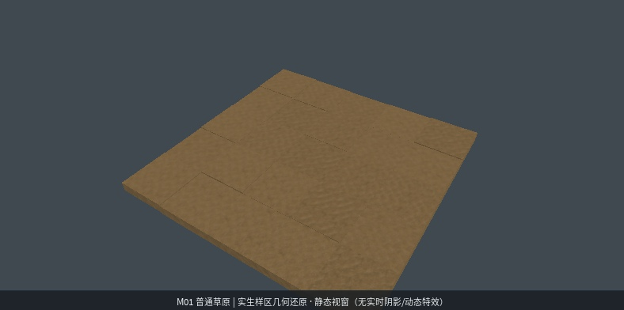</a> | 土黄褐色平整地面，颗粒状材质和直线拼缝清楚；本样区没有混入建筑或草树，便于审查基础地表。 | **普通风蚀砾土荒原**：碎石泥土混合，灰色与黄褐色底土，分布零星干枯草籽；风沙沿凹陷积累，地块四边平滑过渡拼接。 | 5×5样区；保留50-stud地块尺寸、平整可行走面与四向拼接。 |
| M02 T02／抬升山丘 | <a href="原版截图/M02.jpg">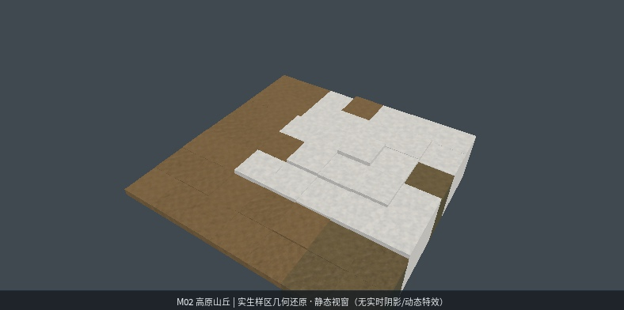</a> | 棕土地面与白色顶面混拼，中心逐级升高，直角台阶和层间高差明显。该样本由本轮land类型的抬升区域选出，不按白色外观误判为雪原。 | **风蚀灰岩高地地块**：剥落岩层与褐土混合，硬质台地边缘有风化碎石；高差断崖带风蚀垂直裂纹，无植被覆盖。 | 7×7样区；保留台阶标高和原通行关系，改岩层与土层外观。 |
| M03 T03＋T13／下沉事件区 | <a href="原版截图/M03.jpg">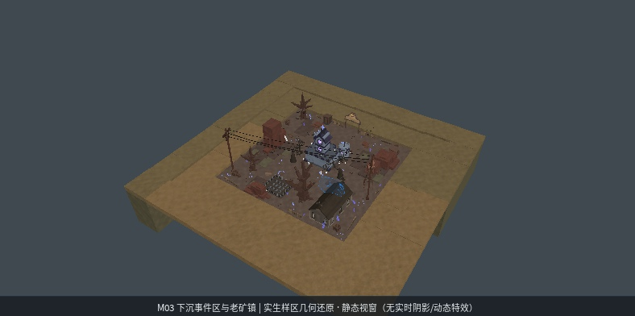</a> [中心近景](#detail-m03d) | 本轮选择老矿镇事件：深色镇区嵌入土黄平地，内有枯树、建筑、电线与特殊构件。单独低位模板没有保留为独立样本，不能把镇区截图当成雷神锤坑。 | **洼地积尘平原地块**：细颗粒干黏土与下沉风沙，暗灰褐色；凹陷处微有湿气暗色，表面散落战前碎金属片。 下沉空间沿用爆破冲击坑凹地的风蚀、烧蚀与积尘语言；镇内建筑需另按B15设定逐体改造。 | 9×9样区；保留下沉空间、道路、建筑入口、事件点；本轮没有雷神锤坑截图。 |
| M04 T07／普通池塘 | <a href="原版截图/M04.jpg">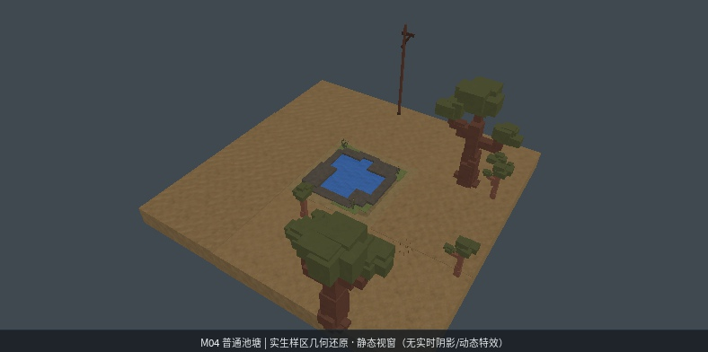</a> | 角状蓝色池面嵌入土黄地块，岸边为深灰与绿色块状轮廓；附近有块状树木与直立杆，尺度关系清楚。 | **废土浑浊水塘地块**：浅棕色泥沙浑浊水体，池底为沉积灰泥；水面悬浮小气泡与油膜，池塘边缘散落废铁桶与枯枝。 | 3×3样区；保持水位、岸线占地和原水域脚本，废桶/枯枝不得堵塞原通路。 |
| M05 T06／沼泽陆地 | <a href="原版截图/M05.jpg">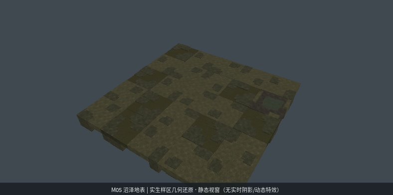</a> | 黄绿、橄榄褐色地块相间，散布深色矩形湿斑与浅凹陷，局部池面呈暗绿；整体仍是大块低多边形地面。 | **湿腐黑泥地表地块**：暗深褐色潮湿泥苔，混合腐殖质与败叶；踩踏沉降感纹理，表面散落小水洼与发芽变异真菌。 | 5×5样区；地表/湿斑分层，保留原生地块边界和沼泽区域身份。 |
| M06 T09／沼泽水地 | <a href="原版截图/M06.jpg">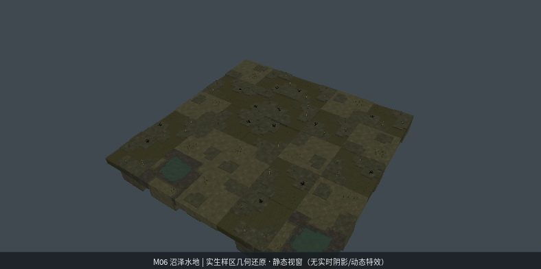</a> | 湿地与水洼交错，池面呈暗绿，周边零散细草/尖叶小簇，地表水陆边界依赖颜色和凹陷区分。 | **湿腐深水沼泽地块**：深黑褐色湿腐水体，水面散落浮萍与腐木；水质极浑浊，边缘有水生变异植物根系缠绕。 | 5×5样区；保留水位与水陆交界；浮萍/腐木是视觉配套，不新增可踩平台。 |
| M07 T10／毒沼泽 | <a href="原版截图/M07.jpg">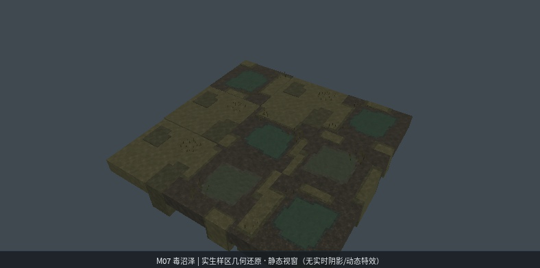</a> [单地块近景](#detail-m07d) | 深色角状岸沿包住绿池，池缘有小型尖叶/菌簇，静态视窗中未呈现完整毒气与动态效果；原版没有新版高亮荧光绿的材质语言。 | **极毒发光沼泽地块**：荧光深绿与紫油膜毒水，气泡破裂效果；水边石块附着发光真菌，散落变异生物骨骸。 | 3×3＋1×1近景；保留毒区触发范围；荧光用于识别危险，局部紫色是油膜，不做魔法特效。 |
| M08 T11／泥沼泽 | <a href="原版截图/M08.jpg">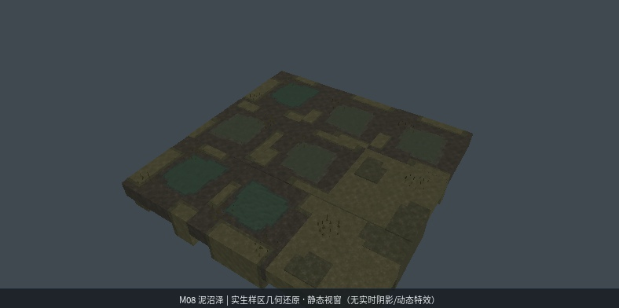</a> [单地块近景](#detail-m08d) | 深褐岸沿围绕灰绿泥面；与毒沼外形接近，但中心颜色更灰暗、浑浊。单块近景用于比较池缘厚度和中心材质。 | **黏稠深泥陷阱地块**：黏稠暗黑泥浆，流动感与沉降开裂表面；泥潭边缘有废旧轮胎与捆绑木板踏脚。 | 3×3＋1×1近景；保留原泥沼范围/效果；轮胎和木板不得静默新增安全路线。 |
| M09 T05＋T14／雪原台地 | <a href="原版截图/M09.jpg">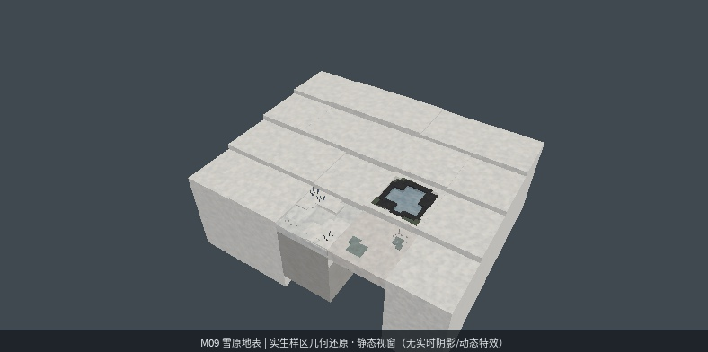</a> | 白色硬雪台阶连续铺开，断面厚而方整，局部露出浅蓝池面和少量尖枝/碎斑；这是地图边缘裁取，名义5×5范围内实际保留20个地面根件。 | **极寒冻土积雪地块**：压实硬雪夹杂黑灰冻土，白与暗灰交错；雪面有风吹微浪纹，边缘露出冰冻碎石。 覆盖层采用风吹覆雪堆积层：覆盖于废木板与地块表面，边缘呈不规则融雪残痕。 | 边缘样区；保留高差与冰冷语义。图示裁切边不代表要在正式地图做缺口。 |
| M10 T08／雪原池塘 | <a href="原版截图/M10.jpg">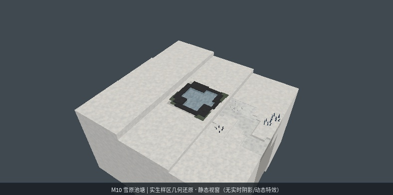</a> [池面近景](#detail-m10d) | 白色台地中央出现方角浅蓝池面，深黑岸缘呈折线围边；近景可辨浅蓝表面纹理与绿色边角，不能单凭图示断言可站立。 | **冻结冰封水塘地块**：冰蓝色半透明厚冰层，冰面开裂与边缘积雪；冰层下方可见冻结的战前废弃机械与沉渣。 | 3×3＋1×1近景；厚冰作为外观提案，保留原水位、通行/碰撞及触发判定；不自动增加踩冰能力。 |
| M11 T12／铁路地面 | <a href="原版截图/M11.jpg">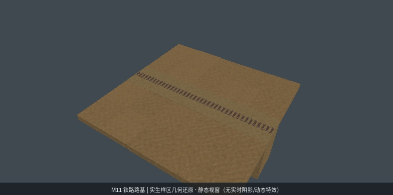</a> | 直线轨道横贯土黄地面，连续枕木与细钢轨形成窄条；周边地面平整，没有在本次展示中加入列车。 | **废弃荒原铁道路基**：碎石道床与锈蚀变折钢轨，枕木半腐朽剥落；轨缝间生长杂草，轨旁散落废弃螺栓与角钢。 | 5×5样区；轨距、轨面高度、中心线与列车净空保持，锈蚀变形只作用于允许的外观。 |
| M12／M13 T04／5级与6级地表 | <a href="原版截图/M12.jpg">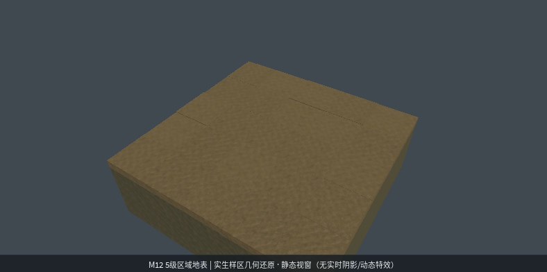</a> <a href="原版截图/M13.jpg">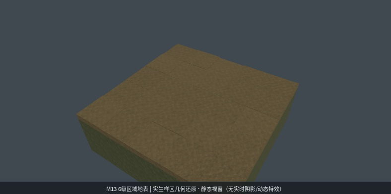</a> | 两类地块当前都呈土黄褐色颗粒表面，厚块侧壁可见；仅看截图难以区分等级，分别依据本轮模板指纹与等级记录取样。 | **辐射废渣荒地地块**：暗紫褐色干土，夹杂烧灼黑斑与战前熔融金属颗粒；局部有微弱化学油膜色泽，龟裂缝隙呈暗褐色。 | 各5×5样区；统一废渣地表家族，仍由工程身份决定5/6级，不能用颜色代替等级判定。 |
| M15 T15＋T14／雪山山体 | <a href="原版截图/M15.jpg">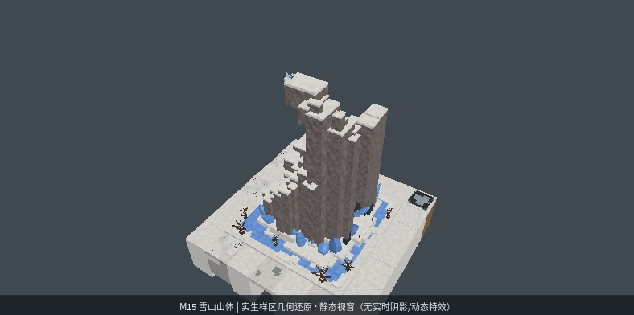</a> [崖壁近景](#detail-m15d) | 多根高耸灰岩立柱构成陡崖，白色台阶/雪帽覆盖顶部，底部有蓝冰尖块和枯枝；近景能辨垂直岩纹与雪帽厚度。 | **风蚀雪山陡崖体**：灰黑硬质山岩与厚重冻冰陡崖；崖壁挂冰锥，高海拔处带白风雪雾气遮罩。 | 完整山体＋周边7×7范围及崖壁近景；保留原山路/平台/阶段与Boss空间；图中不演示暴雪时序。 |
| M16 T16／洞穴地表入口 | <a href="原版截图/M16.jpg">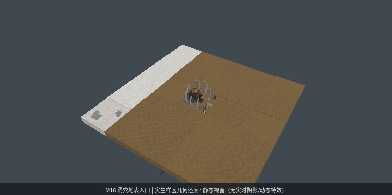</a> [入口近景](#detail-m16d) | 地表入口由灰白巨骨围拢黑色岩状核心，旁边有墓碑/碎骨小件，邻近棕土与白雪交界；本图只取地表部分，不含地下战场。 | **废弃矿洞/掩体入口**：坍塌混凝土与粗工字钢支撑架，洞内暗灰岩壁；洞口堆防爆砂袋与废铁门，洞内散落废弹壳。 | 周边5×5＋入口近景；用新材料对应原入口轮廓，保留交互、传送和通道关系；地下场景需另拍。 |

## 主要细节补图

### M03D 下沉事件中心与老矿镇

观察镇区嵌入范围、原道路和轮廓；本轮没有命中雷神锤事件。

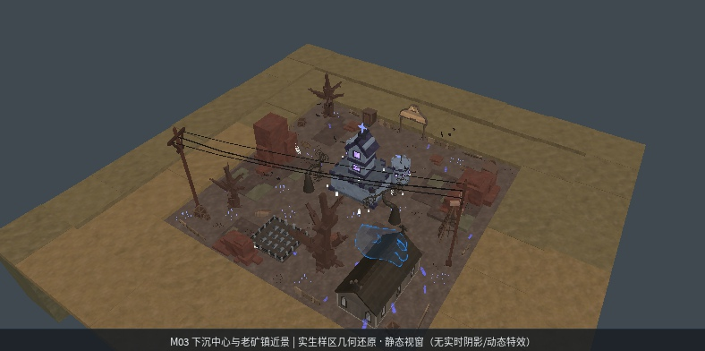

### M07D 毒沼泽单地块

比较绿池、深色岸缘及小型菌/叶簇；毒气动态不在静态视窗中完整呈现。

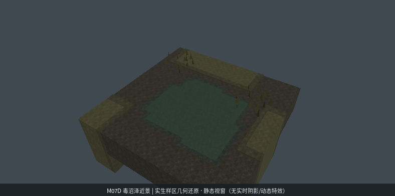

### M08D 泥沼泽单地块

比较灰绿中心泥面与岸沿，不将它与毒沼的危险识别色混用。

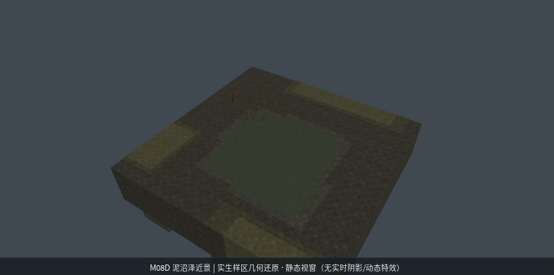

### M10D 雪原池塘单地块

查看池面、折线岸缘和雪层；新版冰壳仅为当前外观设计。

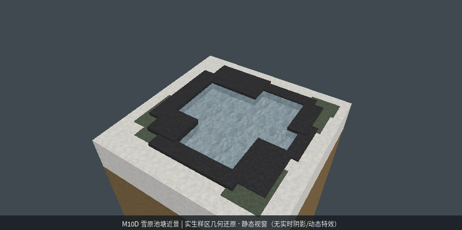

### M15D 雪山崖壁

查看白雪覆顶、垂直岩面与冰块；近景有意裁去周边地面。

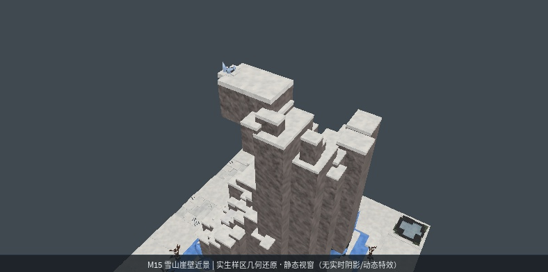

### M16D 洞穴入口

查看骨架/岩核/墓碑的原轮廓，供工字钢和混凝土掩体做对应替换。

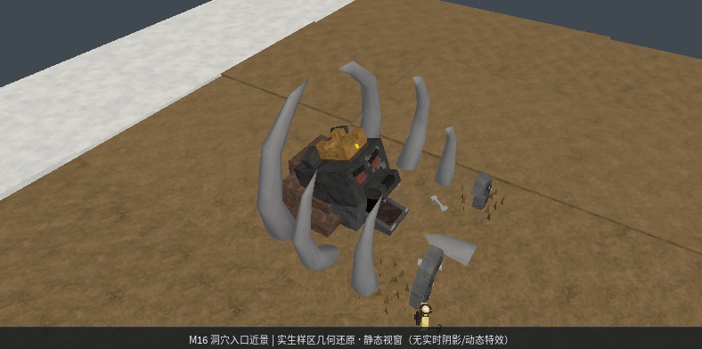

## 本轮未单独拍摄的项目

| 项目 | 本轮处理 |
| --- | --- |
| T03独立低位地块 | 本轮下沉中心被老矿镇替换，使用M03/M03D说明这一实际结果，不伪造一次额外生成。 |
| T13雷神锤事件坑 | 本轮选中老矿镇而非雷神锤；没有雷神锤坑原版截图，概念描述仅沿用已确认的冲击坑设计语言。 |
| T14覆盖层 | 随M09/M10/M15一起观察，未把覆盖层悬空当作完整地块。 |
| T17边界屏障 | 本轮重点为主要可玩地表，未另拍整圈空气墙/远景边界。 |
| T18尖岩／T19云罩 | 正式宿主或使用状态仍待核实，不强行编入这轮实生地貌截图。 |

## 新世界观地貌假想生成图

**AI概念图，供美术方向审查。** 计划构图：上方为完整方形地图的鸟瞰构想，下方为干旱砾土、毒沼岸线、冰雪岩地三个近景。以大中央初始区与四个L形区域为结构参考；生成图不保证逐格精确，不能代替规划格归属数据。

本次为观察地貌组合而暂定“北侧干旱高原、东侧工业/铁路、南侧沼泽、西侧雪原”的概念分布；生态区位置尚未配置进生成器。概念总览不是逐项同机位效果对比，后续单资产换皮图仍按设定集要求沿用原机位、比例与占地。

**生成状态：未完成。** 内置image_gen返回HTTP 401：当前IP未获授权（Your IP is not authorized to make this request.）。因此没有可供展示的概念图，下面仅保留构图方案与已准备好的提示词。恢复内置生图权限后可直接重试；CLI/API备用方式需要另行明确授权并配置OPENAI_API_KEY。详见[生成状态](概念图生成状态.json)。

计划采用内置image_gen生成，目前尚未成功。完整最终提示词见[生图提示词](新世界观地貌_最终生图提示词.txt)。确认基准为：灾后约200年、低多边形主体＋风格化PBR质感、灰褐风蚀地表、湿腐黑泥、局部毒绿/紫油膜、极寒雪岩、褪色警戒漆与废料修补；不增加霓虹朋克、魔法、悬浮建筑或写实内脏。

## 复核材料

- [本轮地图摘要](实生地图记录.json)：沼泽中心(45,45)、雪原中心(10,45)，铁路贯穿z=16，老矿镇中心(14,11)，记录本轮实际出现的地表类型及取景坐标。
- [截图清单](截图清单.json)：21张截图的样区范围、原坐标、几何规模、显示缩放与预加载情况。
- [已确认设定提取](已确认设定提取.json)：20条全局设定和19条地貌设定的工作映射。
- [新布局规划说明](../地图分区分析/05_正方形地图_中心与全图外延一圈.md)：65×65全图、25×25初始区、营地5×5、四区各900块。
- [Studio清理结果](清理结果.json)：Play已停止，临时观察器/视窗/展示副本清除，相机与原界面恢复；没有保存或发布游戏。
