# 职业资料表

废土职业原型的序号可回查[族群与阵营设定集](./wasteland_peoples_and_factions_catalog-v3.md)。头饰方案以帽型和头部附件区分职业，可点击网页中的策划YY图查看原图。

当前大厅的 24 个公开职业。永久购买与租赁均以钻石计价，公开职业的租赁时长为 1 小时。能力按等级列出，外观图来自 Roblox Studio，将各职业的帽饰、披风与护甲装到同一个基础头像上拍摄。

| 职业 | 能力 | Studio 外观 | 购买价 | 租赁价 | 废土设定对应 | 头饰方案 | 策划YY图 |
|---|---|---|---:|---:|---|---|---|
| Musician | 1 级 弹吉他为自己疗伤，间隔 15 秒 · 2 级 可治疗附近的人，间隔 10 秒 · 3 级 附近疗愈间隔缩到 5 秒 | 黑色高顶礼帽  | 6 | 2 | **流亡乐师** 02 废土流民 吉他自疗与范围疗愈对应随营地迁徙的支援者 | 黑色高顶礼帽、酒红补丁帽带、琴弦形铜别针 |  |
| Survivor | 1 级 自带旧灯，饥饿消耗降低 10% · 2 级 夜视改善 · 3 级 开局多带一份汤 | 深棕短檐帽，帽带有金色扣环  | 12 | 4 | **废墟幸存者** 01 废土拾荒者 耐饥、夜视和开局旧灯适合长期独行的废墟居民 | 深棕短檐帽、偏置小琥珀灯、浅布补丁 | 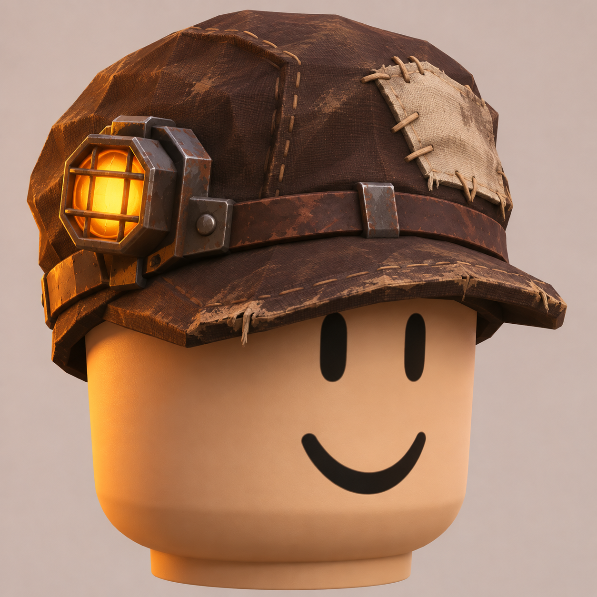 |
| Cooker | 1 级 开局带烹饪锅 · 2 级 煮汤速度提高 20% · 3 级 有 20% 概率煮出完美汤 | 白色高顶厨师帽  | 30 | 10 | **营地炊事员** 02 废土流民 开局烹饪锅和煮汤加成对应为迁徙队伍负责热食的人 | 奶白折褶厨师帽、油渍、搪瓷汤勺徽章 | 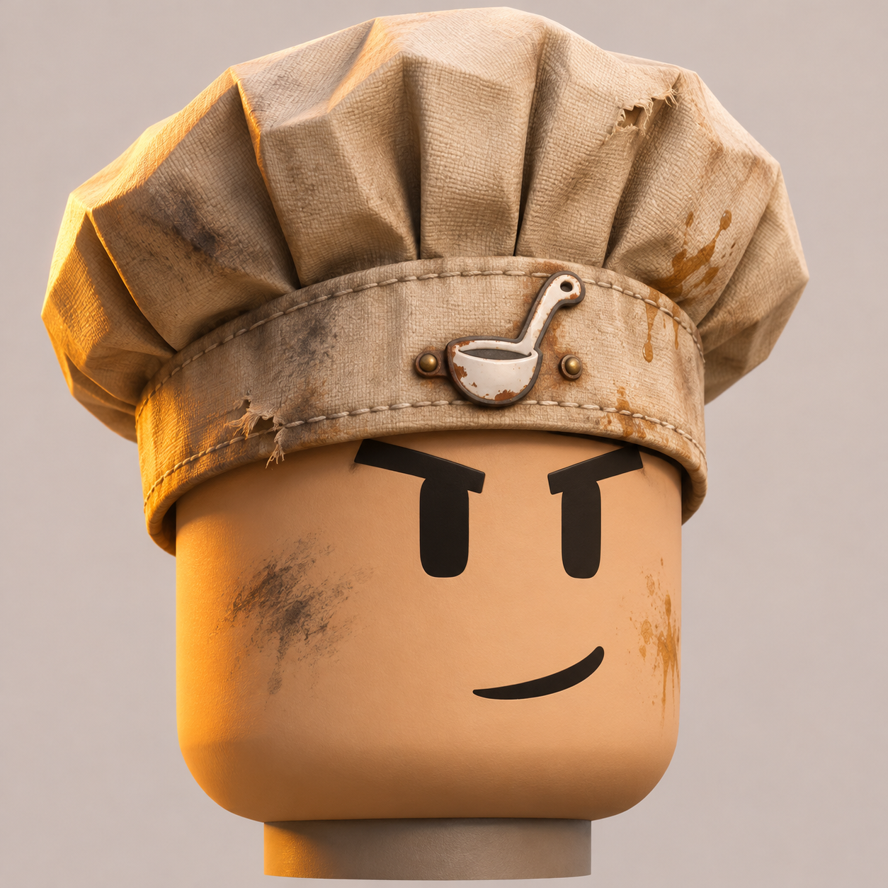 |
| Farmer | 1 级 开局带一块农田 · 2 级 农田更容易长出大作物 · 3 级 农田有机会长出其他种类的产物 | 棕黄色草编宽檐帽  | 50 | 10 | **棚室种植员** 25 驼峰王国商队与聚居地居民 从荒漠聚居地取农业生活原型，农田技能对应在缺水环境下经营食物产出 | 扁顶宽檐草帽、深绿帽带、搪瓷叶扣 |  |
| Woodie | 1 级 开局带好斧，砍树有 20% 概率多出 1 木料 · 2 级 已有种子掉落时，有 25% 概率使其翻倍 · 3 级 砍树有 20% 概率多出 1–2 木料 | 深灰色毛绒护耳帽  | 70 | 20 | **林区伐木工** 01 废土拾荒者 好斧、额外木料和种子构成伐木与补种循环 | 深灰毛绒护耳帽、厚实下垂耳片、木纹扣 |  |
| Sheriff | 1 级 开局带左轮和备用弹药 · 2 级 开火有 10% 概率免耗弹 · 3 级 提高开局备用弹药 | 带金色星徽的棕色牛仔帽  | 80 | 20 | **聚居地治安官** 16 巨石城警卫／执法者 起始左轮与备用弹贴合小型聚居地执法者 | 棕色卷檐牛仔帽、正面大铜星徽 |  |
| West Settler | 1 级 开局有马，提高骑乘速度与跳跃 · 2 级 坐骑姿态增加 10 个袋位，起身后取消 · 3 级 进一步提高马的跳跃，降低骑乘耐力消耗 | 深棕色大宽檐牛仔帽  | 400 | 20 | **商路骑手** 25 驼峰王国商队骑兵 坐骑与骑乘时的额外袋位对应商队的长途运输 | 超宽深棕骑帽、编织帽绳、赭黄风沙面巾 | 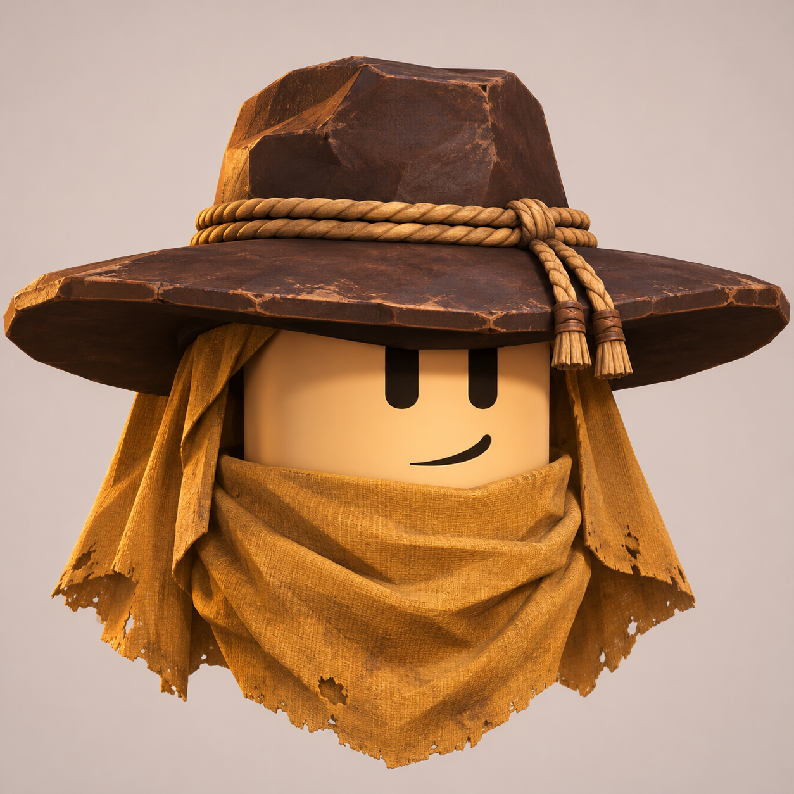 |
| Light Saber Master | 1 级 开局带光剑，可格挡／反射子弹，持剑移速提高 15% · 2 级 持剑时最大生命提高 15% · 3 级 持剑时光剑伤害提高 50% | 白色锥形斗笠，两侧垂下浅色挂饰  | 600 | 30 | **热刃近卫** 23 圣光骑士团 从原型取重甲和高能刃的视觉，突出持剑、格挡与进攻切换 | 象牙白陶瓷斗笠、窄金边、两条侧挂布饰 |  |
| Ronnie | 1 级 举哑铃累积肌肉，持铃时肌肉停止自然衰减 · 2 级 肌肉值超过 75 时有机会瞬间砍倒树或击倒动物 · 3 级 肌肉上限提至 150，中等肌肉值时移速提高 10% | 头部两侧各有一个黑灰色哑铃配件  | 800 | 30 | **废料场力士** 17 外城工匠与劳工 通过举哑铃强化自己，适合以搬运和拆解废料为生的普通人 | 黑铁半盔、前额厚皮垫、配重形侧板 | 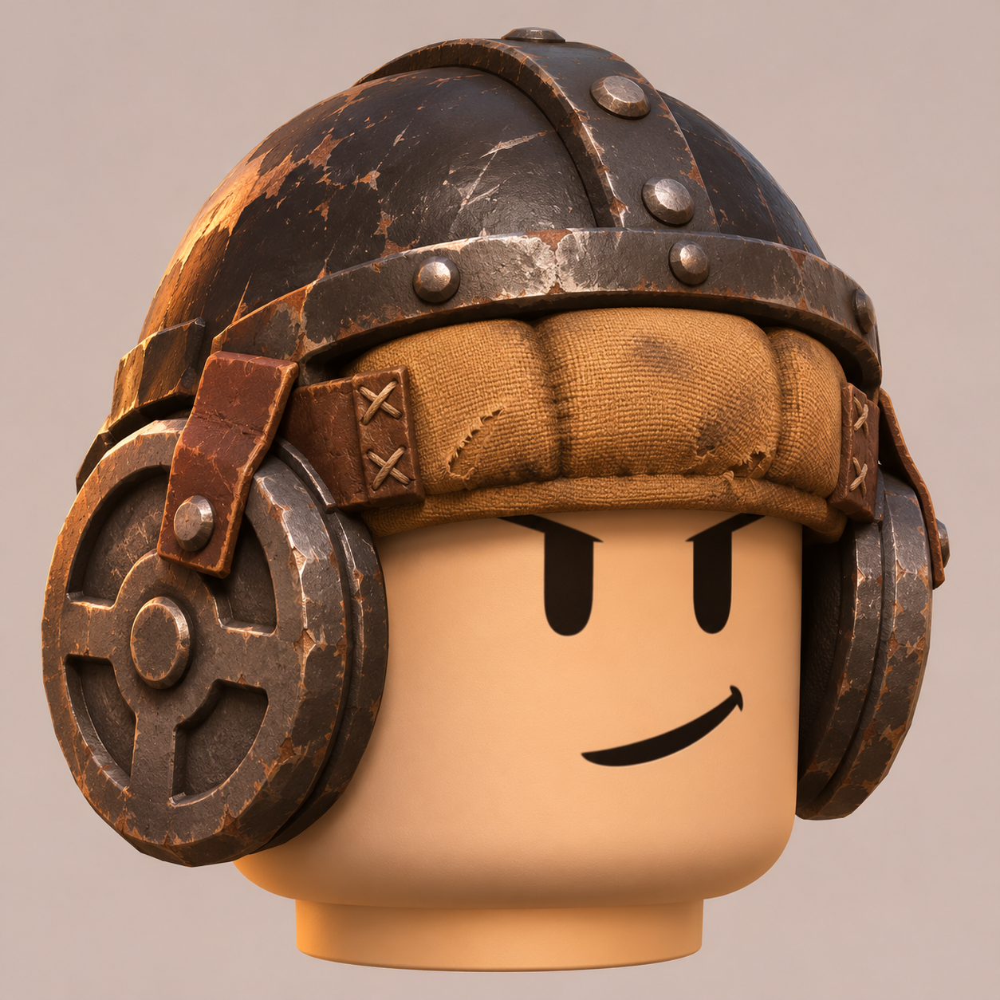 |
| Vampire | 1 级 白天最大生命降低，夜间强化，仅能吃生肉。命中有 20% 概率回复 20 生命 · 2 级 吸血概率提高到 30% · 3 级 吸血概率提高到 50% | 橙色高立领披风，带黑色部件  | 400 | 30 | **夜行尸鬼** 36 清醒尸鬼 白天弱、夜间强、命中回补生命，加上饮食限制，适合一个特殊的夜行个体 | 深色尖兜帽、焦橙护额、开口露出尸鬼轮廓 | 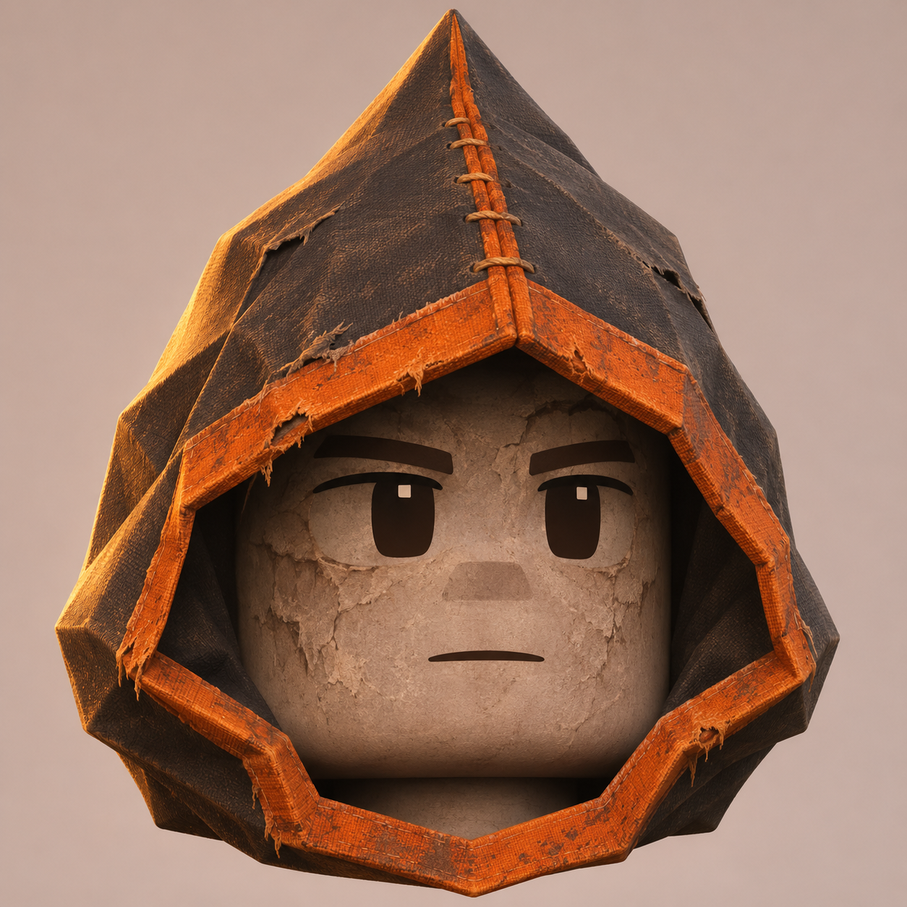 |
| Doctor | 1 级 开局带 2 条绷带，医疗物品治疗量提高 50% · 2 级 开局带急救包，治疗速度提高 50% · 3 级 可消耗自身生命救起队友，冷却约 5 分钟 | 白色医生帽，帽前有浅蓝圆形额镜  | 60 | 15 | **外勤医务员** 20 学院研究员 绷带、急救、治疗强化和复活对应有临床背景的外勤人员 | 象牙白折边医务帽、圆形前额反光镜、暗红织标 | 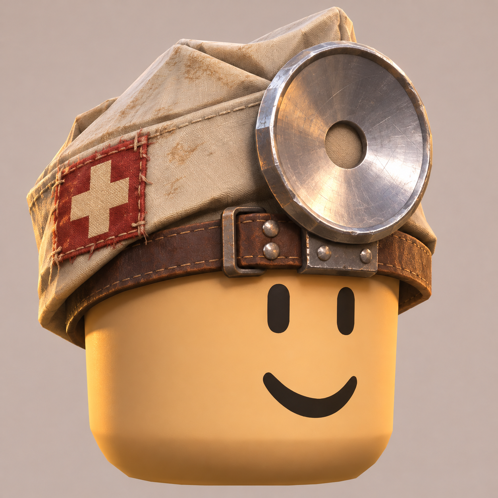 |
| Poison Master | 1 级 开局带毒弓和面罩，毒伤提高 15% · 2 级 毒伤提高至 30%，弓装填加快 25% · 3 级 毒伤提高至 45%，每次射击有 20% 概率触发双箭 | 黑白羽毛头冠，青绿色和金黄色额带  | 250 | 20 | **荒林毒箭师** 10 变种人萨满／巫医 取草药辨识与氏族装束作原型，游戏分工为带毒伤的弓手 | 黑白羽冠、青金与黄铜额带、短面巾 | 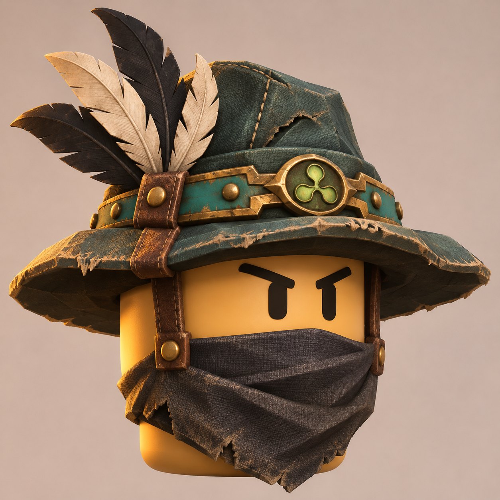 |
| Gatling Master | 1 级 开局带加特林，持枪时移速不降低 · 2 级 有 10% 概率免耗弹 · 3 级 开局多 100 发弹药，命中有 10% 概率触发燃烧 | 黑色宽檐牛仔帽，带金色帽箍和铆钉  | 600 | 30 | **重火力手** 12 军团基层士兵 机动持重武器、弹药节省和持续输出贴合成体系的重火力岗位 | 墨绿硬质宽檐帽、成对厚耳罩、宽帽箍 | 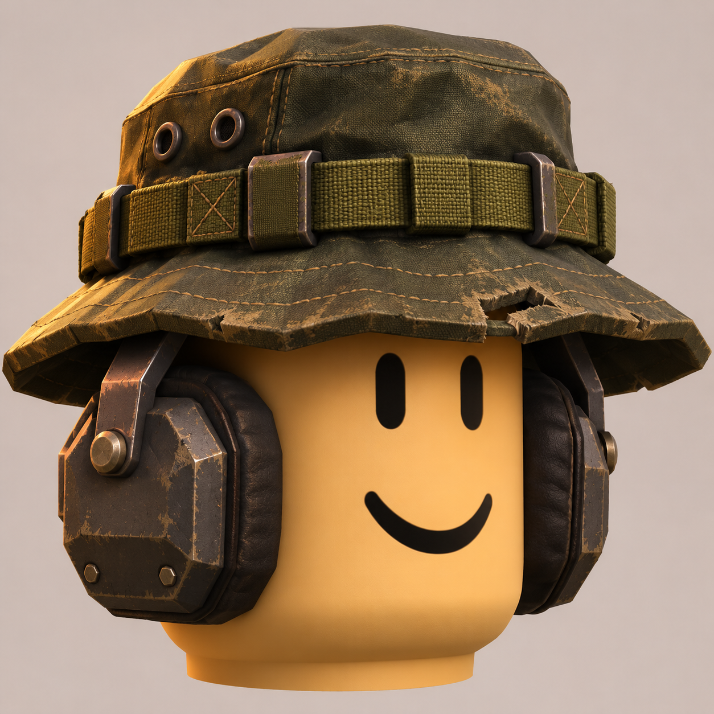 |
| Worker | 1 级 开局带锤，尝试把共享工作台升 1 级 · 2 级 有机会免材料制作建筑或设施 · 3 级 职业说明增加造弹免料，局内判断实际读取二级标签 | 棕色高帽，帽带上有蓝镜片和金色护目镜  | 200 | 20 | **工坊技师** 17 外城工匠与劳工 开局提升共享工作台、免料制作对应在工坊负责生产的人 | 油污灰短帽、上翻双蓝镜片、黄铜卡扣 |  |
| No Name | 1 级 开局带 Peacekeeper。命中蓄能，蓄满后可锁定附近目标的头部 · 2 级 扩大技能瞄准范围 · 3 级 提高技能伤害和蓄能速度 | 深色弹饰宽檐帽，暗红围巾与垂布  | 600 | 30 | **无名游枪手** 36 清醒尸鬼 旧枪、连击蓄能与精确射击适合有地表生涯的独行老枪手 | 旧黑色高冠宽檐帽、哑铜节段帽带、暗红遮脸巾 | 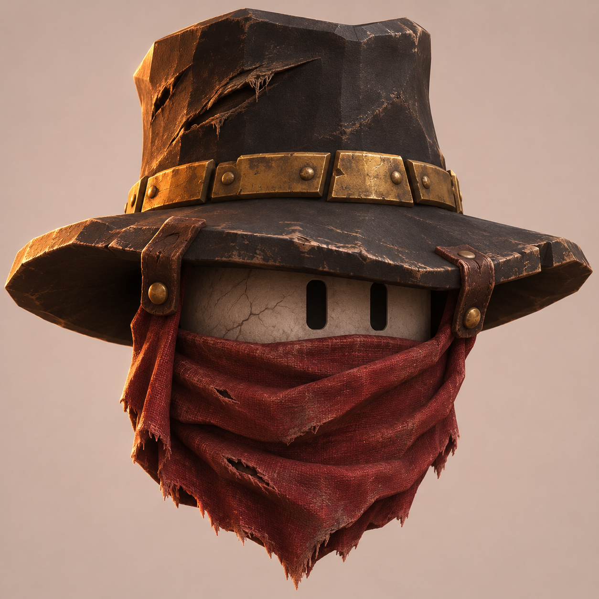 |
| Thor | 1 级 开局带雷神锤和护甲。命中蓄雷，蓄满后下一击引发落雷 · 2 级 扩大落雷伤害范围 · 3 级 提高落雷伤害和每次命中的蓄能 | 金色翼角头盔、黑金肩甲、红披风  | 1000 | 50 | **电弧重装兵** 28 战前人联轨道空降兵 将原型的动力装甲套在蓄能落雷的重装打法上，视觉主体是护甲与电弧 | 黑金全盔、双翼形耳甲、冷蓝发光条 | 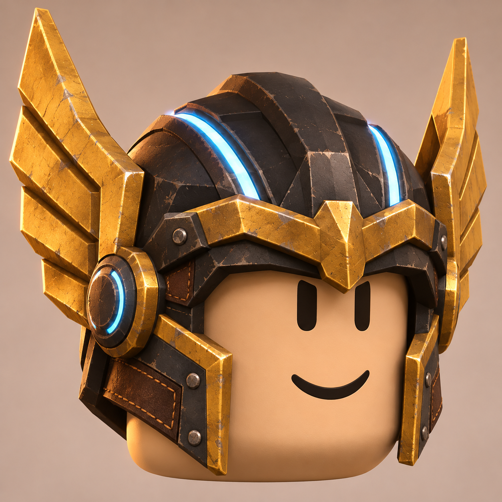 |
| Traveller | 1 级 开局带靴子和梯子，提高走路、攀爬和跳跃能力 · 2 级 开箱加快 25%，夜视改善 · 3 级 背包容量增加 3 格 | 白色宽檐探险帽，带深色帽带  | 50 | 10 | **遗迹勘探员** 21 学院勘探员／调查员 开局梯子、攀爬、夜视和开箱加成直接对应遗迹外勤 | 浅灰宽檐远行帽、短灰护颈兜布、黑色测绘镜片 |  |
| Beast Master | 1 级 召唤兽伙伴并喂肉强化 · 2 级 喂废铁切换金属形态，击倒目标有机会掉废铁 · 3 级 喂尸体切换僵尸形态，攻击有机会吸血 | 尖耳兽头兜帽，深色口鼻与琥珀色眼睛  | 600 | 30 | **变异兽驯养员** 10 变种人萨满／巫医 召唤兽伙伴与喂养切换形态对应熟悉变异兽习性的饲养者 | 粗皮尖耳兜帽、不对称尖耳、两枚驯养牌 | 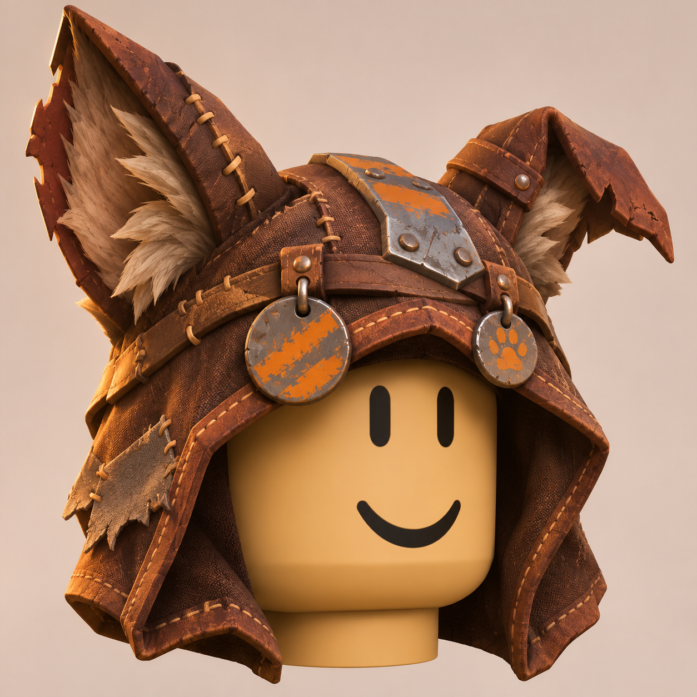 |
| Hunter | 1 级 开局 3 个陷阱，陷阱伤害提高 10% · 2 级 捕猎有机会多得肉，陷阱冷却缩短 1 秒 · 3 级 更易取得兽皮、脂肪，陷阱定身延长 1 秒 | 土黄色迷彩护耳帽  | 150 | 20 | **荒原猎手** 03 废土猎人／荒野猎户 陷阱、额外肉与兽皮产出与原型分工直接吻合 | 土黄护耳猎帽、短硬帽檐、扁平猎夹扣 | 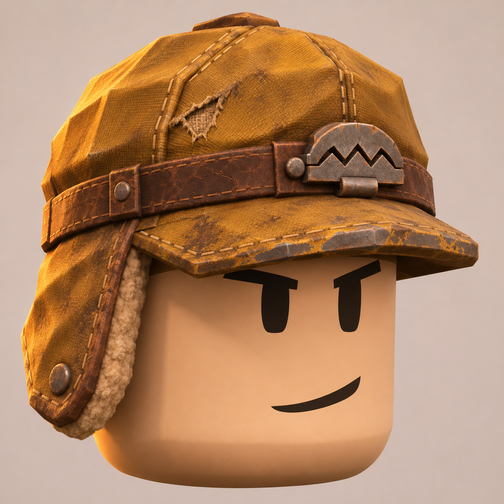 |
| Military Cowboy | 1 级 开局有 2 座自动弩塔，自建防御设施生命提高 · 2 级 开局加 5 铁，防御设施攻击间隔缩短 20% · 3 级 三级技能配置为开局加 10 铁，同时提高防御设施伤害 | 橄榄绿贝雷帽，带金色徽章  | 600 | 40 | **防御工程兵** 19 企业开拓兵团步兵／陆战队 开局自带防御设施并强化其属性，职责是据点布防 | 橄榄绿斜贝雷帽、钢质齿轮徽、加厚皮帽沿 | 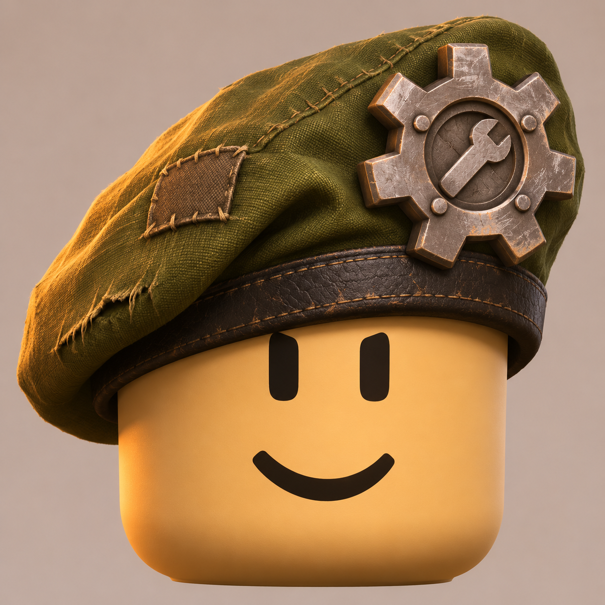 |
| Priest | 1 级 开局带圣水，可伤害幽灵僵尸，也能治疗队友 · 2 级 扩大圣水范围，冷却缩短 2 秒 · 3 级 增加 3 点圣水容量，并提高伤害 | 白金主教帽，帽前与垂带有金色十字  | 400 | 40 | **守灯祭司** 23 圣光骑士团 圣水对幽灵类敌人生效、同时能治疗队友，适合兼营救护与守夜的职务 | 白金高冠祭帽、灯焰徽、短垂带 |  |
| Molotov Cowboy | 1 级 开局有可补充的投掷瓶，容量 5，每 5 秒补 1 个 · 2 级 提升燃烧伤害，每 3 秒补 1 个 · 3 级 容量增加 5，提高爆炸伤害 | 深色高冠宽檐帽，棕色帽带与方扣  | 500 | 50 | **火罐投手** 05 通用掠夺者 借拼接护具与粗制装备的轮廓，对应游戏中的可补充投掷瓶。可设为改行加入外勤队的人 | 高冠炭灰毡帽、焦褐帽边、大方铜扣 |  |
| Ironblood | 1 级 只能吃肉，生命提高 20%，近战伤害提高 35% · 2 级 满血时移速提高 10% · 3 级 饱食度高于 85% 时缓慢回血 | 深蓝包脸头盔，顶部有橙色盔羽 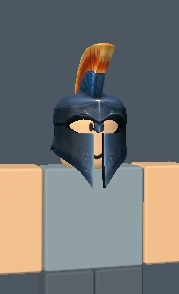 | 400 | 40 | **铁血变种卫士** 08 绿皮变种人 仅吃肉、强化生命和近战，贴合体格强壮的变种近战位。建议保留其交流能力 | 深蓝重盔、大橙盔羽、下颌露出橄榄绿皮肤 | 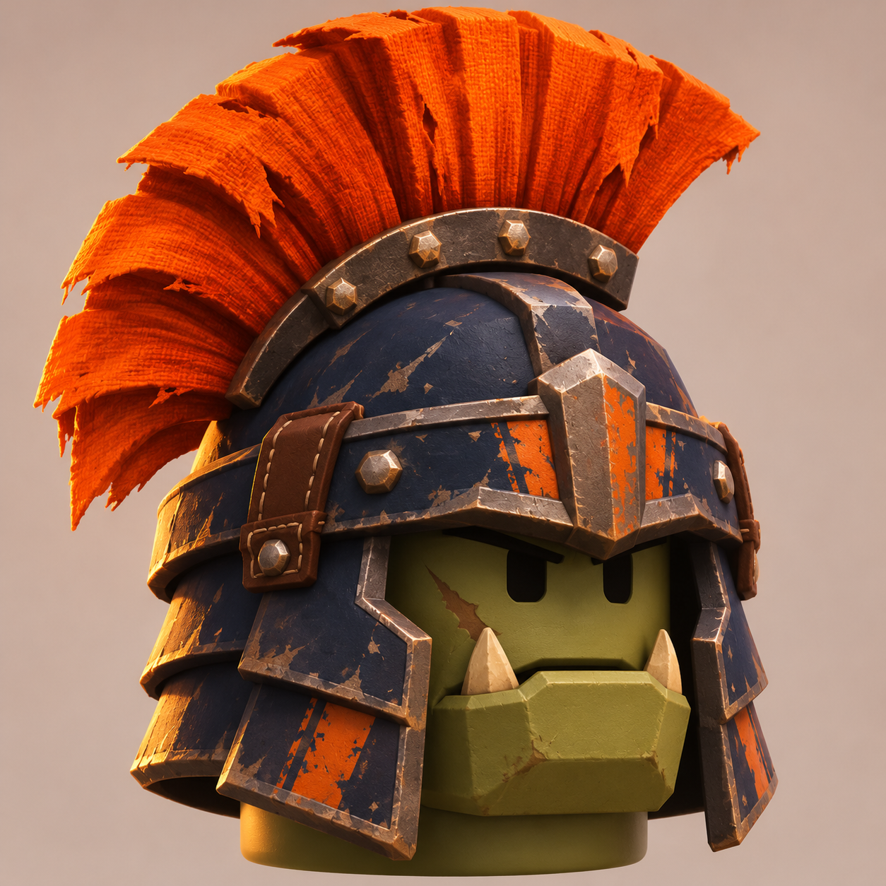 |
| Miner | 1 级 开局有旧镐，夜视改善。挖矿有 20% 概率追加一抽 · 2 级 追加产出变为 25% 概率抽两次 · 3 级 开局旧镐换成银镐 | 白色矿工安全帽，前方有黄色头灯  | 300 | 30 | **矿井勘采员** 17 外城工匠与劳工 夜视、采矿额外产出与银镐自然对应废弃矿井的专业工人 | 白色矿工安全帽、正中大圆黄头灯、煤灰刮痕 | 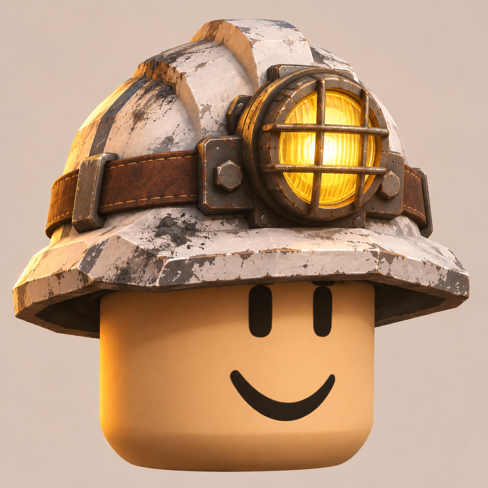 |

## 隐藏配置

下列数值来自配置。两项均未向新玩家公开显示。

| 职业 | 能力 | Studio 外观 | 购买价 | 租赁价 | 废土设定对应 | 头饰方案 | 策划YY图 |
|---|---|---|---:|---:|---|---|---|
| Nobody | 1 级 空手开局，取消各类开局携带道具，并有生存和战斗方面的负面修正 · 2 级 负面修正持续 · 3 级 负面修正持续 | 磨旧的深棕色宽檐牛仔帽  | 300 | 30 | **无名流民** 02 废土流民／难民 空手开局的隐藏挑战项。 | 沿用磨旧的深棕宽檐帽。 | — |
| Admin | 技能栏为管理用途的 Admin 标签 | 帽饰预设为透明占位件，预览只显示基础头像  | 9999（配置值） | 9999（租期 0 秒） | 管理配置 | 透明帽饰占位。 | — |
